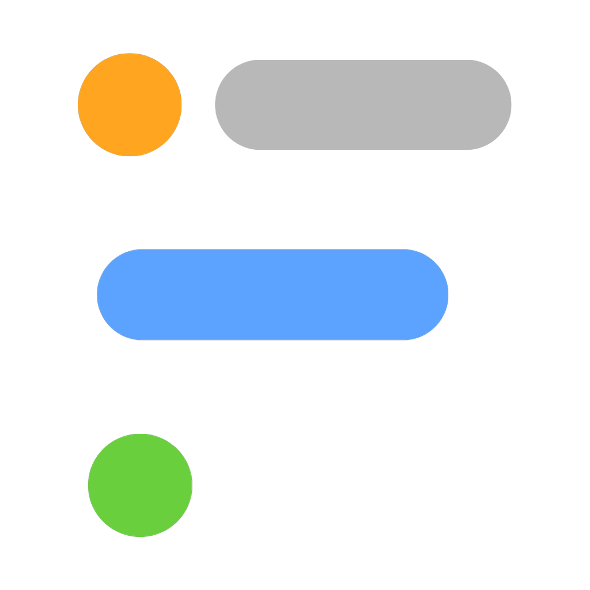
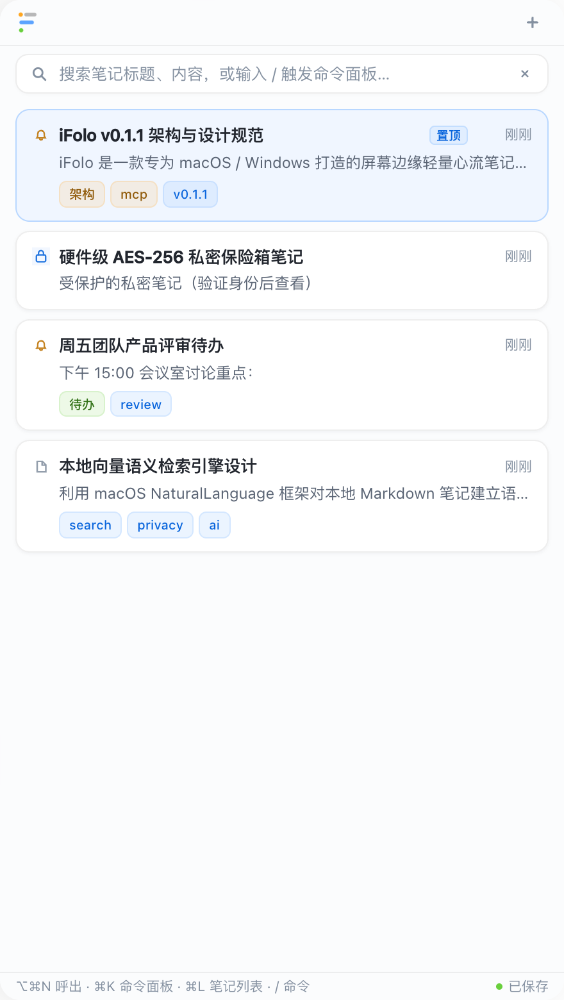
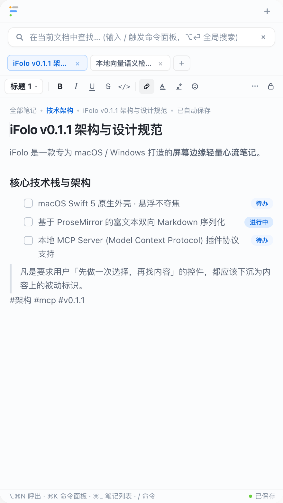

# iFolo Note · 心流笔记

<p align="center">
  
</p>

<p align="center">
  <strong>触手可及的心流笔记，纯本地化数据 无泄漏风险</strong><br>
  <sub>完全本地化数据保护 · 屏幕边缘悬浮 · 原生 AI MCP</sub>
</p>

<p align="center">
  <a href="https://github.com/XideaDev/iFolo/releases/tag/v0.3.1"></a>
  <a href="https://github.com/XideaDev/iFolo/blob/main/LICENSE"></a>
  
  
  
</p>

---

## 💡 产品设计哲学

在日常开发与创作中，切换窗口打开沉重的笔记应用总是会打破思考心流。`iFolo` 专注于做一件纯粹的事情：**让记录随时发生，但绝不打断你手头的工作**。

鼠标碰触屏幕右边缘，笔记面板便静默滑出；写完移开指针或轻按 `Esc`，面板瞬间隐退。整个过程**不抢夺当前应用的系统焦点**，不遮挡核心工作区。数据完全以**纯文本 Markdown 文件**持久化在本地，拒绝数据孤岛与专有格式锁定。

> **核心交互原则**：*凡是要求用户「先做一次选择，再找内容」的控件，都应当下沉为卡片内容上的被动标识。*

---

## 📸 产品界面展示

<div align="center">

| 首页卡片流与分类筛选 | 统一英文短指令命令面板 |
| :---: | :---: |
|  |  |
| **沉浸式富文本 Markdown 编辑** | **macOS 原生卡片流偏好设置 (MCP 生态)** |
|  |  |
| **独立回收站安全管理** | **硬件级私密加密保险箱** |
|  |  |

</div>

---

## 🛠 整体技术架构

iFolo 采用 **「原生系统宿主 + 现代化 Web 编辑内核」** 的混合分层架构。原生外壳提供极致平滑的系统级能力，Web 内核保障跨平台复用性与卓越的文字排版体验。

```
┌────────────────────────────────────────────────────────────────────────┐
│                        macOS 外壳（Swift 5 / AppKit）                   │
│  ├─ 屏幕边缘感知 (NSEvent Monitor, 3pt 热区, 120ms 延时)               │
│  ├─ 悬浮不夺焦架构 (.nonactivatingPanel, NSGlassEffectView 磨砂玻璃)    │
│  ├─ 全局快捷键托管 (Carbon HotKey APIs)                                │
│  ├─ 本地 Markdown 存储引擎 (Store.swift, ~/Library/Application Support) │
│  ├─ 硬件级私密保险箱 (NoteLockManager, CryptoKit AES-256 + Touch ID)  │
│  ├─ 本地向量语义检索引擎 (NaturalLanguage 框架, 离线嵌入向量)           │
│  └─ Model Context Protocol 服务 (MCPServer, STDIO / JSON-RPC 2.0)      │
├────────────────────────────────────────────────────────────────────────┤
│                     双向异步 MessageBridge (WKScriptMessageHandler)    │
├────────────────────────────────────────────────────────────────────────┤
│                     现代化 Web 编辑内核（TypeScript + Vite）           │
│  ├─ ProseMirror 编辑器 (自定义 TaskList、段落控制块手柄、斜杠命令)     │
│  ├─ VS Code 式分类作用域标签组 (TabStrip, 临时预览态 / 固化转正)       │
│  ├─ 结构化命令面板系统 (commands.ts, /new, /find 等 8 组指令与模糊匹配) │
│  ├─ 独立回收站管理视图 (TrashView, 220ms 平滑退场动效, 安全粉碎)        │
│  └─ Markdown 无损双向序列化引擎 (markdown-it + 语法树互转)              │
└────────────────────────────────────────────────────────────────────────┘
```

### 为什么选择这种分工？
1. **外壳坚持纯原生**：边缘感应、悬浮不夺焦、无缝全局快捷键、Liquid Glass 毛玻璃材质与 Touch ID 生物识别认证，任何 Web 封装方案都无法企及系统原生的轻盈与稳定性。
2. **内核坚持 Web 标准**：编辑器采用 TypeScript + ProseMirror 实现，保证复杂的 Markdown 排版、任务列表、富文本高亮可以在未来无缝复用到 Windows 等多端宿主，实现一次编写多端收益。

---

## ✨ 核心特性

- **边缘感知呼出**：将鼠标滑向屏幕最右侧（或按下 `⌥⌘N`），面板即刻浮现；无需在 Dock 或启动台反复寻找应用。
- **悬浮不夺焦 (.nonactivatingPanel)**：查看视频会议、阅读长篇文档或在 IDE 编写代码时随时记笔记，不会抢占输入光标与前台应用状态。
- **VS Code 风格分类标签组**：
  - 标签栏随当前活动笔记的分类（Folder）智能隔离切换。
  - 单击笔记以 *斜体临时预览* 打开，连续查看不占满标签栏；双击或修改内容即刻 **自动固化转正**。
  - 支持 `⌘W` 关闭当前标签与横向无界滑动。
- **极简斜杠命令系统 (Command Palette)**：
  - 在任何搜索输入框键入 `/`，呼出结构化命令面板，配备等宽胶囊徽标与按键提示。
  - 内置 8 组统一短指令：`/new` (新建)、`/list` (列表)、`/find` (全局搜索)、`/filter` (筛选)、`/theme` (主题)、`/settings` (偏好设置)、`/trash` (回收站)、`/esc` (收起)。
  - 智能多通道模糊算法：支持带斜杠或纯英文指令、中文标题与快捷键直接触发。
- **轻量平滑删除与独立回收站**：
  - 彻底淘汰阻断心流的 `window.confirm` 系统弹窗，删除动作伴随 220ms 丝滑折叠退场动画。
  - 内置独立 `/trash` 页面与设置数据流入口，支持误删恢复、单项彻底销毁与批量粉碎。
- **原生 MCP (Model Context Protocol) 本地生态**：
  - 内置 MCP 规范 JSON-RPC 2.0 服务端，无缝对接 Claude Desktop、Cursor、Cline 等 AI 宿主。
  - 暴露 `ifolo_search_notes`、`ifolo_read_note`、`ifolo_append_note` 等原子级工具能力。
  - 独家配备 **DLP 敏感数据防泄漏过滤**（自动脱敏、单次询问、严格拦截）与三态权限安全控制。
- **硬件级私密保险箱 (Touch ID 加密)**：
  - 采用 Apple CryptoKit 与 AES-256-GCM 硬件加密算法，私密笔记在磁盘上完全加密存储。
  - 离开或闲置后自动锁定，支持轻触 Touch ID 或系统密码无感解密。

---

## 📊 开发进度与功能完成度

| 模块 | 功能项 | 状态 | 说明 |
| :--- | :--- | :---: | :--- |
| **原生外壳** | 屏幕边缘贴边热区呼出 | ✅ 已完成 | 3pt 贴边检测，120ms 延时防误触 |
| | `.nonactivatingPanel` 悬浮不夺焦 | ✅ 已完成 | 保持前台应用活跃，输入完全隔离 |
| | Liquid Glass 材质与动态透明度 | ✅ 已完成 | 支持在状态栏与偏好设置即时微调 |
| | 状态栏图标与快速菜单 | ✅ 已完成 | 支持切换图标风格、快速新建与状态调节 |
| **编辑器内核**| ProseMirror 富文本双向 Markdown | ✅ 已完成 | 标题、列表、引用、代码块与高精度序列化 |
| | 6 色任务状态胶囊 | ✅ 已完成 | `todo`, `inProgress`, `done`, `cancelled` 等 |
| | 块级手柄与上下文控制 | ✅ 已完成 | 鼠标悬停行首弹出快速变换工具 |
| | VS Code 式分类作用域标签组 | ✅ 已完成 | 预览/永久态流转、`⌘W` 关闭、工作区记忆 |
| **导航与检索**| 统一规范命令面板 (8 大极简指令) | ✅ 已完成 | `/new`, `/list`, `/find`, `/trash` 等及徽标 |
| | 全库混合语义检索引擎 | ✅ 已完成 | NaturalLanguage 词向量与全文关键词混合评分 |
| | 首页搜索栏常驻与 Esc 体验 | ✅ 已完成 | Esc 优先清空检索词与失焦，绝不误收起搜索框 |
| **数据与安全**| 本地纯文本 Markdown 存储 | ✅ 已完成 | 存储于 `~/Library/Application Support/iFolo/notes/` |
| | 独立回收站管理与安全恢复 | ✅ 已完成 | 平滑退场动效，支持恢复与单项/全量彻底粉碎 |
| | 硬件级私密加密笔记保险箱 | ✅ 已完成 | AES-256 落盘加密 + Touch ID 生物识别解锁 |
| | MCP 服务端与 DLP 防泄密策略 | ✅ 已完成 | 三态权限审计、本地日志记录、敏感词自动脱敏 |
| **分发与打包**| 苹果设计风格 DMG 镜像 (双架构) | ✅ 已完成 | 配备优雅的 Retina 背景与拖拽安装底座 |
| **多端生态**  | Windows 原生外壳 (WinUI 3 / C++) | 🚧 规划中 | 计划于 v0.2.0 里程碑推进 |
| | E2EE 端到端加密多设备云端同步 | 🚧 规划中 | 计划于 v0.3.0 支持 iCloud 与自建 WebDAV |

---

## 🗺 未来路线规划 (Roadmap)

```
[ v0.2.0 (当前稳定版) ]
  ├─ 屏幕边缘交互精细打磨 & 悬浮不夺焦
  ├─ 8 组极简短指令命令面板 & 独立回收站管理
  ├─ MCP 本地生态与敏感数据 DLP 策略
  ├─ 硬件级私密笔记保险箱 (Touch ID / AES-256)
  └─ Apple Silicon (arm64) 与 Intel (x86_64) 双架构 Apple 风格 DMG 发布
        │
        ▼
[ v0.2.0 (跨平台破局) ]
  ├─ Windows 原生外壳发布（WinUI 3 + C++，对齐屏幕边缘感应与沉浸亚克力 Acrylic 材质）
  ├─ 编辑器内核全面跨端适配与统一
  └─ 全局热键系统多端对齐
        │
        ▼
[ v0.3.0 (端到端加密同步) ]
  ├─ 跨设备端到端零知识加密（E2EE）同步引擎
  ├─ 官方端到端 iCloud 同步支持
  ├─ 自建私有化同步协议（支持 WebDAV、S3 兼容对象存储与本地局域网 P2P 同步）
  └─ 冲突解决与版本历史回溯
        │
        ▼
[ v0.4.0 (AI Agent 深度协作) ]
  ├─ MCP 生态深度增强，支持与 Claude / Cursor / OpenCode 双向实时协同
  ├─ 离线本地大语言模型（Ollama / MLX）智能润色与笔记摘要
  └─ 开放轻量前端插件扩展标准
```

---

## 📦 下载与安装

进入 [GitHub Releases](https://github.com/XideaDev/iFolo/releases) 页面下载适合您设备架构的安装包：

- **Apple Silicon (M1/M2/M3/M4 系列)**：下载 `iFolo-0.3.1-arm64.dmg`
- **Intel 架构 Mac**：下载 `iFolo-0.3.1-x86_64.dmg`

双击挂载 DMG 镜像，将 `iFolo.app` 拖入 `Applications` 文件夹即可完成安装。

---

## 💻 本地构建与开发

### 环境要求
- macOS 14.0 (Sonoma) 或更高版本
- Node.js >= 20.0，包管理器推荐 `pnpm`
- Xcode 命令行工具（提供 `swiftc`）

### 1. 运行与调试前端编辑器
```bash
# 安装依赖
pnpm install

# 启动 Web 编辑器本地调试
pnpm --filter @ifolo/editor dev

# 编译编辑器产物至 packages/editor/dist
pnpm --filter @ifolo/editor build
```

### 2. 构建与运行 macOS 原生客户端
```bash
# 一键编译前端并构建 macOS 应用并启动
pnpm run run:macos

# 查看应用运行排错日志
tail -f ~/Library/Logs/iFolo.log
```

### 3. 构建高品质双架构 DMG 镜像
```bash
# 一键自动编译 arm64 与 x86_64 双版 .app 并打包设计款 DMG 镜像
./apps/macos/build-dmg.sh

# 编译完成后的产物将自动输出至 dist/ 目录：
#   dist/iFolo-0.3.1-arm64.dmg
#   dist/iFolo-0.3.1-x86_64.dmg
```

---

## ⌨️ 常用快捷键

| 操作 | 快捷键 / 触发方式 |
| :--- | :--- |
| **呼出 / 收起 iFolo 面板** | 鼠标轻移至屏幕右边缘，或按 `⌥⌘N` |
| **新建空白笔记** | `⌘N` (或在命令面板输入 `/new`) |
| **切换全部笔记列表** | `⌘L` (或在命令面板输入 `/list`) |
| **全库全局语义检索** | `⌘F` (或在命令面板输入 `/find`) |
| **唤起极简命令面板** | `⌘K`，或在搜索输入框直接键入 `/` |
| **打开偏好设置** | `⌘,` (或在命令面板输入 `/settings`) |
| **关闭当前编辑标签** | `⌘W` |
| **返回上一层 / 收起面板** | `Esc` |
| **编辑器段落斜杠菜单** | 在正文空行输入 `/` |

---

## 📄 开源许可

本项目遵循 [MIT License](LICENSE) 开源协议。
